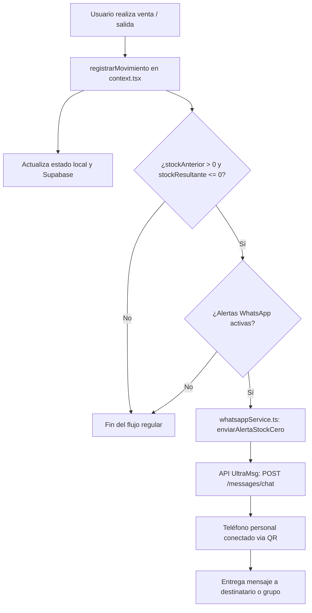

# Especificación de Diseño: Alertas de WhatsApp al Agotar Stock (Stock Cero)

**Fecha:** 2026-10-04  
**Estado:** Aprobado  
**Tipo:** Arquitectural  

---

## 1. Resumen y Objetivos

El objetivo de esta funcionalidad es alertar inmediatamente vía WhatsApp cuando un producto o repuesto agote sus existencias (`existencia === 0`) tras una venta, salida de inventario o actualización de existencias en el sistema de inventario Génesis.

### Requerimientos Clave:
1. **Envío desde número propio mediante QR:** Utilizar un gateway listo para la nube (UltraMsg) donde el usuario conecta su propio número de WhatsApp escaneando un código QR.
2. **Detección de Stock Cero:** Detectar cuando un movimiento de tipo salida transiciona el stock de `> 0` a `<= 0`.
3. **Destinatario flexible:** Posibilidad de enviar las alertas a un número individual (por ejemplo, el propio administrador o compras) o a un Grupo de WhatsApp (mediante Chat ID de grupo).
4. **Panel de Control y Configuración en la App:** Modal intuitivo para activar/desactivar alertas, ingresar credenciales (`Instance ID` y `Token`), configurar destinatario y realizar un test de envío instantáneo.
5. **Respaldo SQL para PostgreSQL / Supabase:** Trigger PL/pgSQL con `pg_net` para permitir que actualizaciones directas en la base de datos también puedan invocar la alerta.

---

## 2. Arquitectura de la Solución



### Componentes:
- **`src/types.ts`:**
  - Definición de tipos para `WhatsAppConfig`:
    - `activo: boolean`
    - `instanceId: string`
    - `token: string`
    - `tipoDestinatario: 'individual' | 'grupo'`
    - `destinatario: string`
    - `notificarStockMinimo: boolean`
  - Definición de `WhatsAppNotificationPayload`.
- **`src/lib/whatsappService.ts`:**
  - Persistencia de configuración en `localStorage` (con fallback de variables de entorno si existen).
  - Función `enviarMensajeWhatsApp(to, body)`: Realiza petición `fetch` a UltraMsg.
  - Función `enviarAlertaStockCero(payload)`: Construye mensaje con plantilla amigable y emojis.
  - Función `probarConexionWhatsApp()`: Envía mensaje de prueba de verificación.
- **`src/context.tsx`:**
  - Integración en `registrarMovimiento`: evalúa la condición de agotamiento y dispara `enviarAlertaStockCero` en segundo plano sin interrumpir la operación principal.
  - Exposición de `whatsAppConfig` y `actualizarWhatsAppConfig` a los componentes consumidores.
- **`src/components/ModalConfigWhatsApp.tsx`:**
  - Modal estilizado para configuración de WhatsApp.
  - Campos de entrada, selector de individual/grupo, botón de prueba en vivo con indicador de carga y feedback de éxito/error.
- **`src/components/Layout.tsx`:**
  - Botón con icono de WhatsApp e indicador de estado (verde si está activo, gris si no) en la barra superior.
- **`docs/triggers/whatsapp_stock_cero.sql`:**
  - Función PL/pgSQL y Trigger en Supabase/PostgreSQL usando `pg_net` para invocación directa desde la base de datos si se requiere.

---

## 3. Formato del Mensaje de Alerta

```text
🚨 *¡ALERTA DE STOCK AGOTADO!* 🚨
----------------------------------
📦 *Producto:* [Nombre del Repuesto]
🏷️ *Código:* [Código de Parte]
🏢 *Sucursal:* [Sucursal 1 / Sucursal 2]
📉 *Stock restante:* 0 unidades
👤 *Despachado por:* [Nombre del Usuario]
📝 *Motivo / Folio:* [Motivo] ([Folio Referencia])
⏰ *Fecha y hora:* [YYYY-MM-DD HH:mm]
----------------------------------
⚠️ Se requiere reposición urgente de inventario.
```

---

## 4. Manejo de Errores y Casos Borde

1. **Fallo de Red o Token Inválido:** El error se atrapa con `.catch()`, registrándolo en consola con advertencia y mostrando un toast no intrusivo. Jamás bloquea la venta o la transacción en el inventario.
2. **Alertas Duplicadas:** Solo se notifica en transiciones `stockAnterior > 0 && stockResultante <= 0`. Si el stock ya estaba en 0 y se modifica una nota o precio, no se envía alerta.
3. **Formato de Número:** Limpieza automática de espacios, guiones y símbolos `+` para que UltraMsg reciba el número en formato internacional limpio (ej. `50212345678`).
4. **Grupos de WhatsApp:** Soporte para formato `@g.us` requerido por UltraMsg.

---

## 5. Plan de Pruebas y Validación

1. **Prueba de Interfaz:** Abrir el modal de configuración de WhatsApp desde el header, ingresar datos y presionar "Probar Envío a WhatsApp". Verificar retroalimentación visual de éxito o error.
2. **Prueba de Salida Normal:** Descontar stock manteniendo existencia > 0. Confirmar que no se envía mensaje.
3. **Prueba de Stock Cero:** Descontar toda la existencia restante de un producto. Confirmar que el movimiento se guarda y la función de alerta a WhatsApp se ejecuta.
4. **Prueba de Persistencia:** Recargar la página y verificar que las credenciales sigan guardadas.
